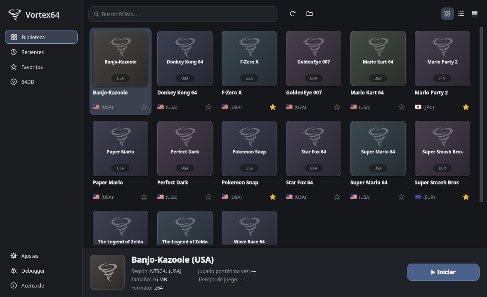

<div align="center">

# 🌀 Vortex64

**Native Nintendo 64 emulator for Linux** · *Emulador de Nintendo 64 nativo para Linux*


[⬇ Download](../../releases/latest) · [Compatibility](Docs/COMPATIBILITY.md) · [Changelog](Docs/CHANGELOG.md) · [Español](README.md)

</div>

---

Vortex64 is an N64 emulator with its own Qt6 interface, built on the core of
[Project64](https://github.com/project64/project64) (GPLv2): core, RSP and recompiler, with SDL2/OpenGL backends.
It is a plain ELF binary: **no Wine, no Proton**. Port and development by **SugarSV11**.

> Bring your **own ROMs**. This project does not include or distribute any ROM or Nintendo content.


<sub>Library with fake test ROMs (no Nintendo content).</sub>

## Features

- MIPS R4300i core (interpreter and x86-64 recompiler), RSP, TLB and saves
- OpenGL video through SDL2, embedded in the main window (built-in plugin, optional GLideN64)
- SDL2 / PipeWire audio and keyboard, mouse and gamepad input (SDL2)
- Qt6 UI: ROM browser, favorites, settings, cheats and enhancements, save states
- Debugger with windows and JavaScript scripting
- `.z64`, `.n64`, `.v64` ROMs (also inside `.zip` and `.7z`)
- Desktop integration: icon, `.desktop` entry and MIME association

## Download and run

1. Download `Vortex64-x86_64.AppImage` from [Releases](https://github.com/SugarSV11/Vortex64/releases).
2. Run it:

```bash
chmod +x Vortex64-x86_64.AppImage
./Vortex64-x86_64.AppImage
```

## Build from source

Dependencies (Fedora names; use the `-dev` equivalents on other distros):
`gcc`/`g++` ≥ 13, `cmake` ≥ 3.16, `ninja-build`, `pkgconf`, `SDL2-devel`, `qt6-qtbase-devel`,
`mesa-libGL-devel`, `pipewire-devel`, `alsa-lib-devel`, `freetype-devel`, `zlib-ng-devel`.

```bash
git clone https://github.com/SugarSV11/Vortex64.git
cd Vortex64
cmake -S . -B build -G Ninja -DCMAKE_BUILD_TYPE=Release
cmake --build build
./build/bin/vortex64
```

- `-DPJ64_GLIDEN64=OFF` disables the alternative GLideN64 video plugin (no FreeType needed).
- System install: `cmake --install build --prefix ~/.local`.

## Tests

```bash
cmake --build build --target check
ctest --test-dir build --output-on-failure
```

The suite runs headless (Qt offscreen) with fake header-only ROMs: menus, ROM browser, settings, plugin
configuration, input, plugin loading, Project64 migration and first run. Tests that need a real display,
a gamepad or a commercial ROM live in `Scripts/linux/`.

## Status

| Area | Status |
|---|---|
| ROM boot with video, audio and input | Works (verified with a real ROM) |
| Qt6 GUI (browser, settings, cheats, debugger) | Works; see [`Docs/dev/PROJECT64_PARITY.md`](Docs/dev/PROJECT64_PARITY.md) |
| Recompiler (JIT) | Under testing; the interpreter is the reference path |
| Native Wayland | Pending (works through Xwayland today) |
| Flatpak | Pending |

## Compatibility

Per-game results are tracked in [`Docs/COMPATIBILITY.md`](Docs/COMPATIBILITY.md). No game has been
tested yet; every entry is *Pending*. Reports are welcome in [Issues](https://github.com/SugarSV11/Vortex64/issues).

## Known limitations

- The JIT is the youngest part of the core; if a game fails, try the interpreter in the settings.
- No native Wayland yet: it runs through Xwayland.
- No Flatpak yet; the distribution format is the AppImage.

## License and credits

Vortex64 is free software under the **GNU GPL v2** ([`LICENSE`](LICENSE)). It is based on **Project64**
and uses GLideN64, AsmJit, SDL2, Duktape, Discord RPC, the 7-Zip C SDK, zlib/minizip, Berkeley SoftFloat and Qt6.
Full attribution in [`THIRD_PARTY_NOTICES.md`](THIRD_PARTY_NOTICES.md) and [`licenses/`](licenses/).
Nintendo 64 is a trademark of Nintendo; this project is not affiliated with Nintendo or Project64.
