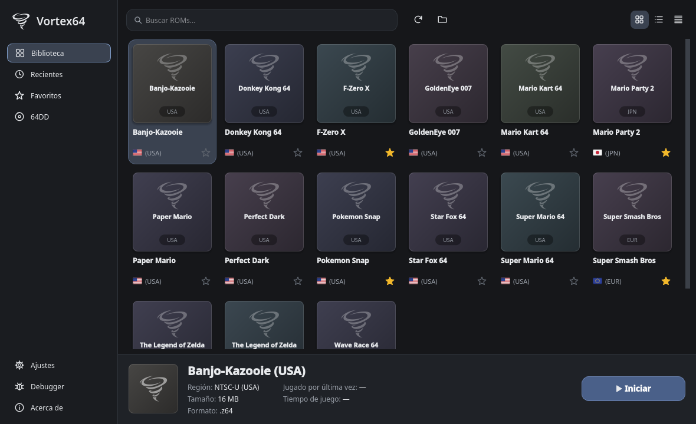

# Vortex64

**Emulador de Nintendo 64 nativo para Linux** · *Native Nintendo 64 emulator for Linux*

Vortex64 es un emulador de N64 para Linux, derivado del núcleo de [Project64](https://github.com/project64/project64)
(núcleo, RSP, recompilador) con interfaz Qt6 y backends SDL2/OpenGL. Es un binario ELF:
**sin Wine, sin Proton**.

> ⚠️ **BETA.** Algunos juegos pueden fallar o ir mal. Si encuentras un fallo, abre un
> [issue](https://github.com/SugarSV11/Vortex64/issues) con tu sistema, la versión y los pasos para reproducirlo.


<sub>Biblioteca con ROMs de prueba falsas (sin contenido de Nintendo).</sub>

## Características

- Núcleo MIPS R4300i (intérprete y recompilador x86-64), RSP, TLB y saves
- Video OpenGL con SDL2, embebido en la ventana principal (plugin propio y GLideN64 opcional)
- Audio SDL2 / PipeWire y entrada por teclado, ratón y mandos (SDL2)
- Interfaz Qt6: navegador de ROMs, favoritos, ajustes, trucos y mejoras, save states
- Depurador con ventanas y scripts JavaScript
- Soporte de ROMs `.z64`, `.n64`, `.v64` (también dentro de `.zip` y `.7z`)
- Integración de escritorio: icono, entrada `.desktop` y asociación MIME

## Descargar y ejecutar

1. Descarga `Vortex64-x86_64.AppImage` desde [Releases](https://github.com/SugarSV11/Vortex64/releases).
2. Ejecútalo:

```bash
chmod +x Vortex64-x86_64.AppImage
./Vortex64-x86_64.AppImage
```

Necesitas tus **propias ROMs**. Este proyecto no incluye ni distribuye ninguna ROM ni contenido de Nintendo.

## Compilar desde el código

Dependencias (nombres de Fedora; en otras distros usa los equivalentes `-dev`):
`gcc`/`g++` ≥ 13, `cmake` ≥ 3.16, `ninja-build`, `pkgconf`, `SDL2-devel`, `qt6-qtbase-devel`,
`mesa-libGL-devel`, `pipewire-devel`, `alsa-lib-devel`, `freetype-devel`, `zlib-ng-devel`.

```bash
git clone https://github.com/SugarSV11/Vortex64.git
cd Vortex64
cmake -S . -B build -G Ninja -DCMAKE_BUILD_TYPE=Release
cmake --build build
./build/bin/vortex64
```

- `-DPJ64_GLIDEN64=OFF` desactiva el plugin de video alternativo GLideN64 (no necesita FreeType).
- Instalación del sistema: `cmake --install build --prefix ~/.local`.
- Detalles del port, pruebas y estado por componente: [`Docs/dev/`](Docs/dev/).

## Tests

```bash
cmake --build build --target check   # compila los tests
ctest --test-dir build --output-on-failure
```

La suite se ejecuta sin pantalla (Qt offscreen), con ROMs falsas de solo cabecera: menús, navegador de ROMs,
ajustes, configuración de plugins, entrada, carga de plugins, migración desde Project64 y primer arranque.
Los tests que necesitan pantalla real, mando o una ROM comercial están en `Scripts/linux/`
(`run-gui-tests.sh`, `input-gamepad-test`).

## AppImage portable

```bash
packaging/linux/build-appimage.sh   # genera Vortex64-x86_64.AppImage
```

Para que corra en cualquier distro (Fedora/Atomic, Ubuntu, Debian, Arch, openSUSE…) se compila en un sistema
con glibc antigua: el workflow `.github/workflows/release.yml` lo hace en ubuntu-22.04. Las librerías se
copian sin modificar (el `patchelf` de linuxdeploy corrompe las librerías modernas) y `check-elf-integrity.py`
lo verifica.

## Estado

| Área | Estado |
|---|---|
| Arranque de ROM con video, audio y entrada | Funciona (verificado con ROM real) |
| GUI Qt6 (navegador, ajustes, trucos, depurador) | Funciona; ver [`Docs/dev/PROJECT64_PARITY.md`](Docs/dev/PROJECT64_PARITY.md) para el detalle por función |
| Recompilador (JIT) | En pruebas; el intérprete es la ruta de referencia |
| Wayland nativo | Pendiente (hoy funciona vía Xwayland) |
| Flatpak | Pendiente |

## Documentación

- [Compilar y empaquetar](#compilar-desde-el-código) · [Tests](#tests)
- [Estado del port a Linux](Docs/dev/LINUX_PORT.md) · [Auditoría](Docs/dev/LINUX_PORT_AUDIT.md)
- [Cambios](Docs/CHANGELOG.md) · [Carpetas de usuario](Docs/USER_FOLDERS.md) · [Soporte](Docs/SUPPORT.md)

## Licencia y créditos

Vortex64 es software libre bajo la **GNU GPL v2** ([`LICENSE`](LICENSE)). Se basa en **Project64**
y usa GLideN64, AsmJit, SDL2, Duktape, Discord RPC, 7-Zip C SDK, zlib/minizip, Berkeley SoftFloat y Qt6.
Atribución completa en [`THIRD_PARTY_NOTICES.md`](THIRD_PARTY_NOTICES.md) y en [`licenses/`](licenses/).
Nintendo 64 es marca de Nintendo; este proyecto no está afiliado a Nintendo ni a Project64.

---

## English summary

Vortex64 is a native Linux port of the Project64 core with a Qt6 UI and SDL2/OpenGL backends
(no Wine/Proton). **Beta software.** Download the AppImage from
[Releases](https://github.com/SugarSV11/Vortex64/releases), `chmod +x` it and run it; bring your own ROMs.
Build: `cmake -S . -B build -G Ninja && cmake --build build` (see dependencies above). GPLv2.
